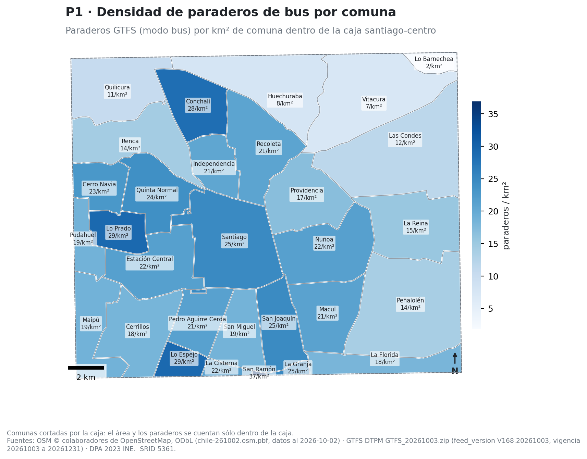
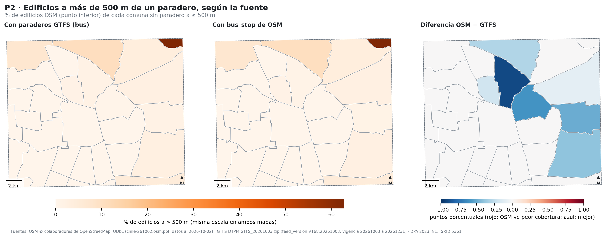
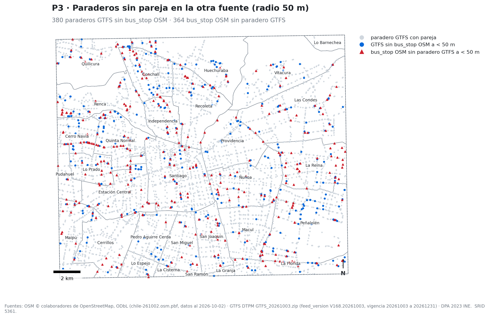
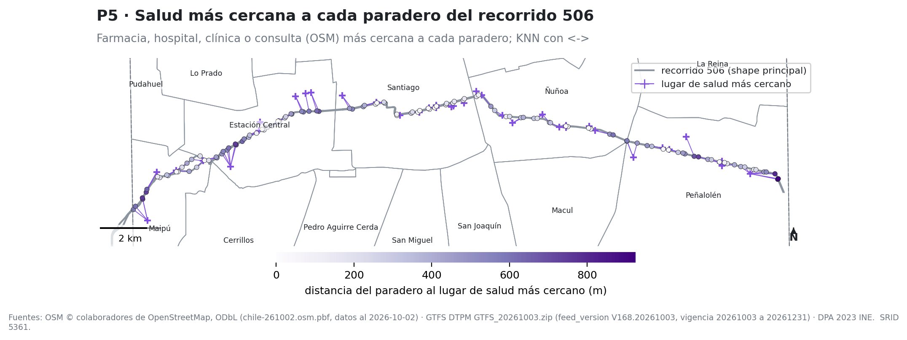
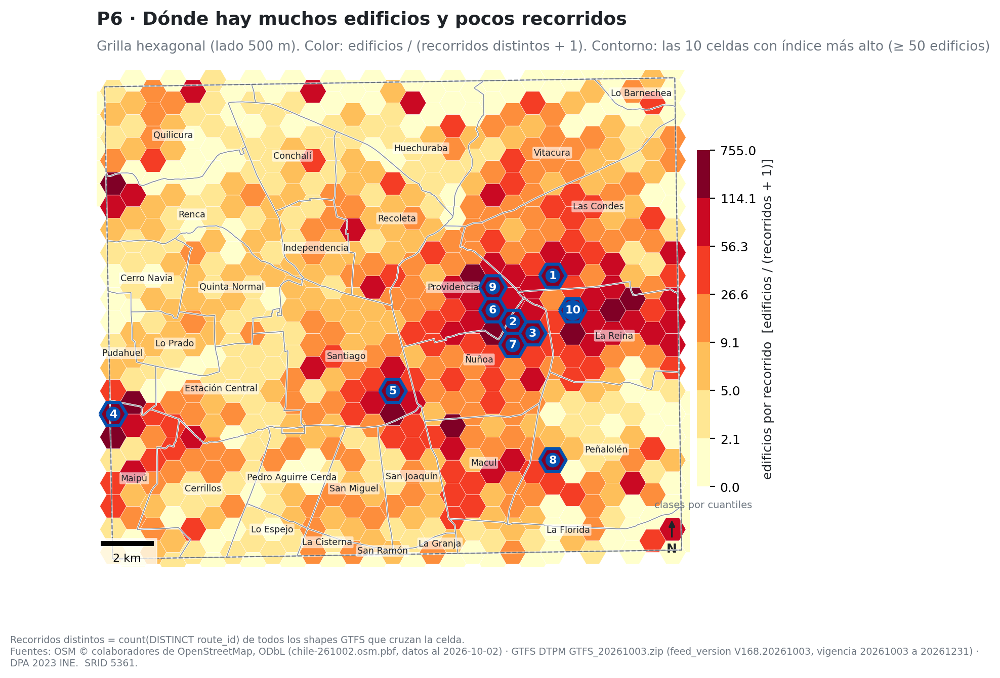
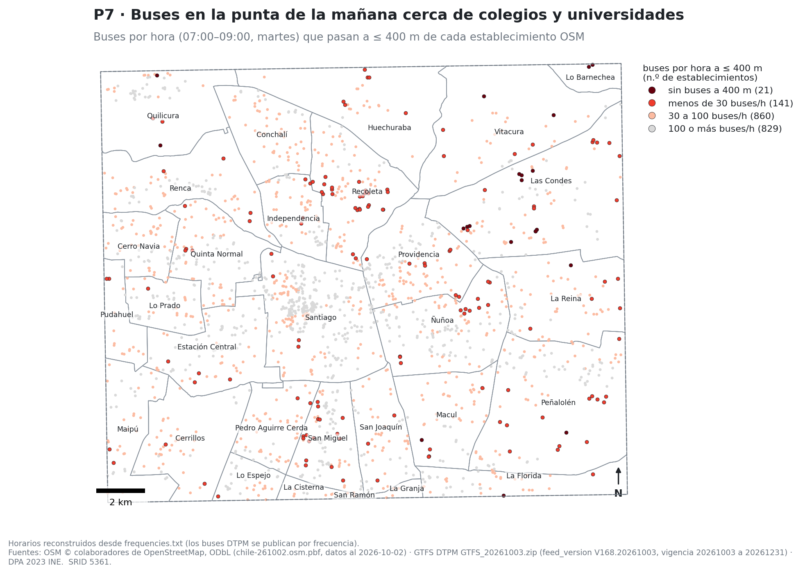

# Tarea 1 — PostGIS de punta a punta: Santiago centro

Bastian Sandoval · Procesamiento Masivo de Datos · USM 2026-2 · Paralelo 701

**Fuentes de todas las conclusiones.** OSM: extracto `chile-latest` de Geofabrik, datos al
**02-10-2026** (20:21 UTC), lo que la comunidad dibujó. GTFS: DTPM `GTFS_20261003.zip`
(`feed_version V168.20261003`, vigencia 03-10 a 31-12-2026), lo que el operador declara; el enunciado
nombra `GTFS_20260829.zip`, que ya no era el vigente al descargar (03-10-2026). Comunas: DPA 2023 (INE).
Zona: caja lon −70,75…−70,52 · lat −33,52…−33,36, todo en **SRID 5361**. De las 30 comunas que tocan
la caja, 13 quedan completas; las otras 17 están cortadas y sus cifras valen sólo para la parte dentro
de la caja. Consultas, resultados y planes completos: `resultados/q*.txt`.

## P1. Paraderos por comuna

Hay **6.569 paraderos de bus** del GTFS en la zona: **17,3 por km²**.

\Needspace{3cm}

| Más densas (completas) | par. | par./km² | | Menos densas | par. | par./km² |
|---|---:|---:|---|---|---:|---:|
| Lo Prado | 191 | 29,2 | | Lo Barnechea (cortada) | 5 | 1,8 |
| Conchalí | 311 | 28,4 | | Vitacura (cortada) | 194 | 7,4 |
| Santiago | 573 | 24,7 | | Huechuraba (cortada) | 165 | 7,9 |
| San Joaquín | 244 | 24,6 | | Quilicura (cortada) | 178 | 10,7 |
| Quinta Normal | 282 | 23,9 | | Las Condes (cortada) | 364 | 11,8 |

**Interpretación.** Según el GTFS de la DTPM (vigente desde el 03-10-2026), la red de paraderos es más
densa en las comunas chicas y compactas del centro-poniente y norte (Lo Prado, Conchalí) que en
Santiago mismo, y cae a menos de la mitad en el nororiente (Vitacura, Huechuraba, Las Condes), donde
hay cerros, parques y manzanas grandes. Santiago es la que más paraderos tiene (573). Entre las
comunas completas la menos densa es Providencia (16,8).

**Plan.** *Nested Loop*: por cada una de las 67 piezas de `comunas_zona_sub` (tabla externa, *Seq
Scan*) se hace un *Index Scan* sobre `paraderos_gtfs_geom_gist` con `geom && s.geom`; el índice está
del lado de los paraderos, la tabla grande. Después `ST_Intersects` descarta los falsos positivos del
bbox (48 por pieza). Con índice: 40 ms. Sin índice: 120 ms, con *Seq Scan* de paraderos y un join que
compara todo contra todo (433.554 pares descartados por el filtro).

{width=58%}

## P2. Cobertura a 500 m (GTFS contra OSM)

De 118.821 edificios de OSM, el **1,14 %** queda a más de 500 m de un paradero de bus del GTFS y el
**0,98 %** a más de 500 m de un `bus_stop` de OSM.

\Needspace{3cm}

| Comuna | edificios | % lejos (GTFS) | % lejos (OSM) | dif. (pp) |
|---|---:|---:|---:|---:|
| Lo Barnechea (cortada, 78 edificios) | 78 | 62,8 | 62,8 | 0,0 |
| Huechuraba | 1.269 | 10,7 | 10,4 | −0,3 |
| Quilicura | 2.291 | 7,5 | 7,5 | 0,0 |
| La Florida | 965 | 4,7 | 4,7 | 0,0 |
| Vitacura | 4.017 | 3,9 | 3,9 | 0,0 |
| 16 comunas (Santiago, Ñuñoa, Macul, …) | | 0,0 | 0,0 | 0,0 |

**Interpretación.** La conclusión **no cambia con la fuente**: las cinco comunas peor cubiertas son las
mismas y en el mismo orden, y la mayor diferencia es de 0,9 puntos (Recoleta). OSM da una cobertura
levemente mejor porque incluye algunos `bus_stop` que el GTFS no declara. La falta de cobertura está en
los bordes de la caja (faldeos de Huechuraba, Quilicura, Lo Barnechea), no en el centro. Dos cautelas:
el dato dice "hay un paradero cerca", no cuántos buses pasan (eso es P7), y los edificios son los que
alguien dibujó en OSM, con cobertura desigual entre comunas.

**Plan.** Dos *Nested Loop Anti Join*: por cada edificio, un *Index Scan* sobre
`paraderos_gtfs_geom_gist` (o `paraderos_osm_geom_gist`) con `geom && ST_Expand(punto, 500)`.
`ST_DWithin` se convierte en una caja de ±500 m que resuelve el GIST, y basta una fila para descartar
el edificio. El índice está del lado de los paraderos; los edificios se recorren completos. Total:
4,2 s para 118.821 edificios. Sin índice el plan estimado es un anti-join con *Seq Scan* de paraderos
por cada edificio (118.821 × 6.569 distancias), con costo estimado de 4,1 × 10⁹.

{width=100%}

## P3. Dos fuentes, un objeto

\Needspace{3cm}

| Sentido (radio 50 m) | total | sin pareja | % |
|---|---:|---:|---:|
| Paraderos GTFS (bus) sin `bus_stop` OSM cerca | 6.569 | 380 | 5,8 |
| `bus_stop` OSM sin paradero GTFS cerca | 6.568 | 364 | 5,5 |

Sensibilidad al radio: con 25 m quedan 1.003 y 995 sin pareja; con 100 m, 141 y 137.

**Interpretación.** Las dos fuentes tienen casi el mismo tamaño y coinciden en el 94 % de los casos
a 50 m, lo que sugiere que en Santiago los `bus_stop` de OSM (al 02-10-2026) vienen en buena parte de
una importación de datos oficiales y no de dibujo independiente. Ninguna es claramente más completa:
a OSM le faltan 380 paraderos que el operador declara (más en Peñalolén, 45, y Quinta Normal, 25), y
OSM tiene 364 que el GTFS vigente no declara (más en La Reina, 30), que pueden ser paraderos
retirados o de servicios fuera del sistema. El resultado depende del radio: a 25 m los "sin pareja"
casi se triplican, así que parte de la diferencia es posición y no existencia. 

{width=68%}

## P4. Kilómetros de recorrido por comuna y efecto de ST_Subdivide

\Needspace{3cm}

| Comuna | km | rutas | km/km² | | Comuna | km | rutas | km/km² |
|---|---:|---:|---:|---|---|---:|---:|---:|
| Santiago | 1.149,9 | 156 | 49,6 | | Ñuñoa | 417,5 | 60 | 24,7 |
| Las Condes | 616,2 | 73 | 19,9 | | Providencia | 399,1 | 81 | 27,6 |
| Estación Central | 534,3 | 81 | 37,2 | | Vitacura | 311,3 | 40 | 11,8 |
| Peñalolén | 459,7 | 68 | 14,9 | | Lo Barnechea | 7,7 | 10 | 2,7 |

Total en la zona: 8.444 km de trazado (un shape principal por ruta y sentido; GTFS del 03-10-2026).

**Interpretación.** Santiago concentra el 14 % de los km con el 6 % de la superficie: 156 de las 347
rutas pasan por ella. Le siguen en intensidad Estación Central (37,2 km/km²) y Lo Prado (33,8), los
corredores de entrada desde el poniente. Vitacura y Huechuraba tienen la cuarta parte de la
intensidad de Santiago.

**ST_Subdivide.** Mismo resultado (8.444,28 km) por los dos caminos: contra las 30 comunas completas,
**439 ms**; contra las 67 piezas de `ST_Subdivide(geom, 128)`, **558 ms** (mejor de 3 corridas). Aquí
subdividir **no ayudó**: las comunas ya están recortadas a la caja y tienen 191 vértices en promedio
(88 por pieza), así que `ST_Intersection` ya era barata, y con piezas hay más pares que intersectar
(4.070 contra 2.589). Subdividir rinde con polígonos de miles de vértices. En ambos planes el índice
usado es `recorridos_geom_gist`, del lado de los recorridos, y filtra poco: descarta 119–132 filas
por cada 61–86 que sirven, porque el bbox de una línea de 20 km cubre media ciudad.

## P5. Vecino más cercano (recorrido 506)

El 506 tiene **117 paraderos** en la zona (los dos sentidos). La farmacia o centro de salud más
cercano de OSM está en promedio a **340 m** (mediana 308 m, máximo 924 m); **30 paraderos (26 %)**
lo tienen a más de 500 m. El más cercano es una farmacia en 58 casos, una clínica o CESFAM en 39 y
una consulta (`doctors`) en 20; nunca un hospital.

**Interpretación.** A lo largo del 506 (Maipú–Peñalolén por 5 de Abril, Av. Matta y Av. Grecia) el
acceso a salud es bueno en el tramo central (decenas de metros en Av. Matta) y peor en los dos
extremos: Pajaritos (583–736 m) y el final en Diagonal Las Torres (802–924 m). Depende de qué
farmacias están dibujadas en OSM al 02-10-2026; en la periferia pueden faltar.

**Plan.** Por cada paradero: `Limit` → *Index Scan* sobre `amenidades_geom_gist` con
`Order By: geom <-> p.geom`. El GIST entrega las amenidades ya ordenadas por distancia y se detiene
en la primera que cumple el filtro de `amenity` (descarta 16 antes de encontrarla). El índice está
del lado de las amenidades. Con índice: 12 ms. Sin índice: 446 ms, con *Seq Scan* de las amenidades
de salud y un *Sort* por distancia repetido 117 veces.

{width=78%}

## P6. Grilla hexagonal de 500 m (mapa principal)

636 celdas; en promedio 186,8 edificios y 11,5 recorridos distintos por celda. 59 celdas no tienen
ningún recorrido, y 4 de ellas tienen 50 edificios o más. Criterio del ranking: índice =
edificios / (recorridos + 1), sólo celdas con al menos 50 edificios.

\Needspace{3cm}

| # | Comuna | edif. | rec. | índice | | # | Comuna | edif. | rec. | índice |
|---|---|---:|---:|---:|---|---|---|---:|---:|---:|
| 1 | Las Condes | 755 | 0 | 755,0 | | 6 | Providencia | 1.028 | 3 | 257,0 |
| 2 | Ñuñoa | 1.344 | 3 | 336,0 | | 7 | Ñuñoa | 765 | 2 | 255,0 |
| 3 | Ñuñoa | 1.321 | 3 | 330,3 | | 8 | Peñalolén | 702 | 2 | 234,0 |
| 4 | Maipú | 2.532 | 7 | 316,5 | | 9 | Providencia | 456 | 1 | 228,0 |
| 5 | Santiago | 2.450 | 7 | 306,3 | | 10 | La Reina | 894 | 3 | 223,5 |

{width=94%}

**Interpretación.** Las celdas con mucha ciudad y poca oferta se agrupan en el límite
Providencia–Ñuñoa–Las Condes–La Reina (7 de las 10): barrios residenciales de casas, muy bien
dibujados en OSM, donde los buses van por las avenidas del borde y no entran. La correlación entre
edificios y recorridos por celda es baja (**r = 0,19**): los recorridos siguen ejes, no la cantidad
de edificios. Cautela: el índice cuenta edificios, no habitantes (una torre vale lo mismo que una
casa), y favorece a las comunas donde OSM está más detallado. El conteo incluye las líneas de
Metro cuyo trazado cruza la celda; por estas 10 no cruza ninguna (todos sus recorridos son de bus) y la
estación más cercana queda a entre 0,5 y 1,4 km del centro de cada celda. Datos: OSM al 02-10-2026,
GTFS vigente desde el 03-10-2026.

**Plan.** *Function Scan* sobre `ST_HexagonGrid` (636 celdas) y, por celda, dos *Index Scan*:
`edificios_punto_gist` (puntos: 187 filas útiles y 63 descartadas) y `recorridos_geom_gist` (líneas:
23 útiles y 100 descartadas). El segundo se lleva la mayor parte de los 1,3 s.

## P7 (propia). Buses en la punta de la mañana cerca de establecimientos educacionales

Para cada colegio, instituto o universidad de OSM (1.851) se cuentan los buses por hora que pasan a
400 m o menos entre 07:00 y 09:00 de un martes, con horarios reconstruidos desde `frequencies.txt`.
Cruza OSM (establecimientos) con GTFS (paraderos y frecuencias), y a diferencia de P2 mide cuánto
servicio hay, no sólo si hay un paradero.

\Needspace{3cm}

| Categoría | establecimientos | % |
|---|---:|---:|
| Sin buses a 400 m | 21 | 1,1 |
| Menos de 30 buses/h | 141 | 7,6 |
| 30 a 100 buses/h | 860 | 46,5 |
| 100 o más buses/h | 829 | 44,8 |

Mediana: 91 buses/h (percentil 10: 32; percentil 90: 225,5).

**Interpretación.** El 91 % de los establecimientos tiene 30 o más buses por hora a distancia
caminable en la punta; el 8,7 % (162) tiene menos de 30 o ninguno. Los mal servidos se concentran
en Recoleta (29,5 % de sus establecimientos), Huechuraba (27,3 %), Las Condes (24,4 %) y Vitacura
(20,0 %); en Santiago es el 1,3 % y la mediana llega a 165,5 buses/h. De los 15 peor servidos con
nombre, 7 son colegios de Las Condes, a 430–510 m del paradero más cercano. Válido para el GTFS
vigente desde el 03-10-2026 y los establecimientos dibujados en OSM al 02-10-2026; un campus
grande se mide desde su punto interior, lo que explica el caso del Campus San Joaquín de la PUC.

{width=72%}

## Decisiones del pipeline

- **SRID 5361 en todo.** Unidades en metros: `ST_DWithin(a, b, 500)` son 500 m reales y usa el
  GIST. OSM se reproyecta al cargar (`ogr2ogr -t_srs`), el GTFS se construye en 4326 y se
  transforma, la DPA ya viene en 5361.
- **Recorte en la base.** `osmium` recorta el PBF de Chile (333 MB → 17 MB); el GTFS se filtra con
  `ST_Intersects` contra la caja; las comunas se recortan a la caja para que áreas, conteos y km se
  midan sobre la misma superficie.
- **Punto interior contra polígono.** `edificios` guarda el polígono (para áreas) y
  `punto = ST_PointOnSurface(geom)`. Contar, asignar a comuna o celda y medir distancias se hace con
  el punto: cada edificio cae en un solo lugar. No se usa el centroide porque en un edificio en L
  puede caer fuera. Las amenidades dibujadas como polígono (hospitales) entran con su punto interior.
- **Reparaciones.** De 146.755 multipolígonos de OSM, **15 inválidos** (14 `Self-intersection`,
  1 `Ring Self-intersection`), todos reparados con `ST_MakeValid` + `ST_CollectionExtract(…, 3)`;
  ninguno quedó vacío. Líneas inválidas: 0. Comunas inválidas en la DPA: 0.
- **GTFS con `COPY`.** `stop_times.txt` tiene 1.098.529 filas y `shapes.txt` 456.573 puntos; se
  cargan con `COPY` a tablas `UNLOGGED` de texto y el GTFS completo queda listo en 17 s.
- **Shapes múltiples por ruta.** 981 `shape_id` en el feed, 708 tocan la caja (347 rutas). Se guardan
  todos, una `LineString` por `shape_id` ordenada por `shape_pt_sequence::int` (como texto,
  `'10' < '9'`). `es_principal` marca el shape con más salidas por ruta y sentido (604): P4 usa sólo
  esos para no sumar la misma calle por cada variante; P6 cuenta `DISTINCT route_id`.
- **Buses por frecuencia.** En el GTFS de la DTPM los `stop_times` de bus son plantillas que parten a
  las 0:00:00; los horarios reales salen de expandir `frequencies.txt` (14.542 filas). P7 usa eso.
- **`ST_Subdivide`.** 30 comunas → 67 piezas. Sirve para el punto-en-polígono (P1, P2, P7); en P4 no
  mejoró el tiempo (ver P4).
- **Índices.** GIST en cada geometría derivada y B-tree en claves y filtros. Según
  `pg_stat_user_indexes` (reiniciado antes de las consultas), los más usados fueron
  `paraderos_gtfs_geom_gist` (148.862 veces), `paraderos_osm_geom_gist` (145.097) y
  `comunas_zona_sub_geom_gist` (120.673). **No se usaron**: `edificios_geom_gist` y
  `calles_geom_gist` (4,9 y 4,2 MB; las preguntas usan el punto interior y ninguna usa calles),
  `recorridos_route_idx`, los dos índices de la grilla (se lee completa) y seis claves primarias.
- **Lo que no funcionó.** Una agregación de `stop_times` dentro de un CTE hizo que el planner
  estimara 1 fila y eligiera un nested loop que no terminaba; se resolvió materializando en una
  tabla temporal con `ANALYZE`. Detalle de ése y otros casos en el README, §7.
- **Tiempos.** Carga completa 124 s; consultas, GeoPackage y mapas 109 s.
